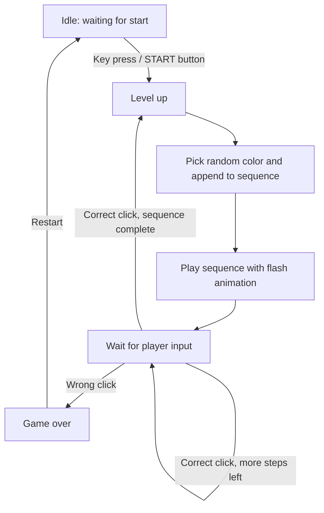

<div align="center">

# 🎨 Color Mania

**A browser-based memory sequence game built with vanilla HTML, CSS, and JavaScript.**

[](https://chintucharan.github.io/simongame/)


[Live Demo](https://chintucharan.github.io/simongame/) · [Report a Bug](https://github.com/Chintucharan/simongame/issues) · [Request a Feature](https://github.com/Chintucharan/simongame/issues)

</div>

---

## Table of Contents

- [Overview](#overview)
- [Demo](#demo)
- [Features](#features)
- [How to Play](#how-to-play)
- [Tech Stack](#tech-stack)
- [Game Flow](#game-flow)
- [Architecture and Design](#architecture-and-design)
- [Project Structure](#project-structure)
- [Getting Started](#getting-started)
- [Deployment](#deployment)
- [Roadmap](#roadmap)
- [What I Learned](#what-i-learned)
- [Contributing](#contributing)
- [Author](#author)

---

## Overview

Color Mania is a Simon-style memory game. The game flashes a growing sequence of colors, and the player must repeat it in the exact order. Each successful round appends one more color, so the memory load increases every level. A single wrong input ends the run.

The project is dependency-free and runs entirely in the browser. It focuses on clean state handling, timed UI feedback, and a responsive layout that works on both desktop and mobile.

## Demo

**Live:** [chintucharan.github.io/simongame](https://chintucharan.github.io/simongame/)

<!-- Replace with a real GIF or screenshot. A short gameplay GIF makes the biggest difference. -->
<!--  -->

| Desktop | Mobile |
| :---: | :---: |
| _Add screenshot_ | _Add screenshot_ |

## Features

- **Dynamic sequence generation:** a new random color is added every round.
- **Progressive difficulty:** the sequence grows by one step after each successful level.
- **Input validation:** every click is checked against the expected position in the sequence.
- **Visual feedback:** separate flash effects distinguish game playback from player input.
- **Score tracking:** the current level is shown during play.
- **Instant restart:** start a new run right after a game over.
- **Responsive UI:** adapts to desktop and mobile screens, with a START button on mobile layouts.

## How to Play

1. Start the game with a keypress, or tap the **START** button on mobile.
2. Watch the sequence of flashing colors.
3. Repeat the sequence by clicking the colors in the same order.
4. Finish the round to move to the next level.
5. One wrong click ends the game.

## Tech Stack

| Technology | Purpose |
| --- | --- |
| HTML5 | Semantic game structure |
| CSS3 | Layout, responsive design, flash animations |
| JavaScript (ES6) | Game logic, state management, input validation, timers |

No frameworks, no build step, no external libraries.

## Game Flow



## Architecture and Design

**State.** The game keeps a small amount of state: whether a game is running, the current level, the generated sequence, and the player's input so far. Everything on screen is derived from that state.

**Input validation.** On every click, the player's input is compared with the generated sequence at the same index. A mismatch ends the game immediately. A full match advances the level. This keeps validation to a constant-time check per click.

**Timed feedback.** Flashes are driven by `setTimeout`, using a short add-then-remove CSS class. Game flashes and user flashes use different classes, so the player can always tell playback from their own input.

**Separation of concerns.** Structure lives in `index.html`, presentation and animations in `style.css`, and behavior in `script.js`.

## Project Structure

```text
simongame/
├── index.html    # Game layout and markup
├── style.css     # Styling, responsive rules, flash animations
├── script.js     # Game logic and event handling
└── README.md
```

## Getting Started

**Prerequisites:** any modern browser. No installation required.

```bash
# 1. Clone the repository
git clone https://github.com/Chintucharan/simongame.git

# 2. Move into the project
cd simongame

# 3. Open the game
open index.html          # macOS
start index.html         # Windows
xdg-open index.html      # Linux
```

Optionally, serve it locally:

```bash
python -m http.server 8000
# then visit http://localhost:8000
```

## Deployment

The project is hosted on **GitHub Pages** directly from the `main` branch. Any push to `main` updates the live site.

## Roadmap

- [ ] Persist the high score with `localStorage`
- [ ] Add per-color sound effects (Web Audio API)
- [ ] Add difficulty modes (playback speed, sequence length)
- [ ] Add a leaderboard
- [ ] Improve accessibility (keyboard navigation, ARIA labels, reduced-motion support)
- [ ] Add unit tests for the sequence and validation logic

## What I Learned

- Managing game state without a framework
- Coordinating asynchronous visual feedback with JavaScript timers
- Handling DOM events and keeping UI in sync with state
- Building a layout that works across desktop and mobile

## Contributing

Contributions and suggestions are welcome.

1. Fork the repository
2. Create a feature branch: `git checkout -b feature/your-feature`
3. Commit your changes: `git commit -m "Add your feature"`
4. Push the branch: `git push origin feature/your-feature`
5. Open a Pull Request

## Author

**Gowni Venkat Charan**

[](https://github.com/Chintucharan)
[](https://www.linkedin.com/in/gowni-venkat-charan-1b06562a8/)

---

<div align="center">

If you enjoyed the game, consider giving the repo a ⭐

</div>
